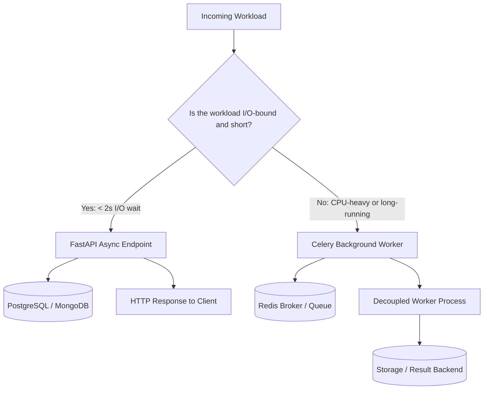

# Async Programming in FastAPI — Architecture & Engineering Trade-offs

## 1. Overview & Context

In TaskFlow Session 05, we introduce asynchronous API execution and evaluate how the FastAPI backend behaves under concurrent I/O-bound load. Specifically, we implement and benchmark a workspace-scoped **Task Summary** endpoint in two variations:
1. **Asynchronous Non-Blocking (`GET /api/v1/tasks/summary`)**: Uses native cooperative concurrency with `asyncio.sleep` to simulate external service communication and enforces an external timeout using `asyncio.wait_for`.
2. **Synchronous Blocking with Thread-Pool Offloading (`GET /api/v1/tasks/summary/blocking`)**: Uses synchronous `time.sleep` offloaded to a bounded `ThreadPoolExecutor(max_workers=4)` via `loop.run_in_executor` to prevent starving the event loop. (Note: pure event-loop starvation from an accidental synchronous call directly inside `async def` is tested and demonstrated in `test_sync_call_inside_async_starves_event_loop`).

---

## 2. Concurrency vs. Parallelism in Python & FastAPI

Understanding why async helps requires distinguishing **concurrency** from **parallelism**:

| Concept | Mechanism | How it Works in Python | Best Suited For |
| :--- | :--- | :--- | :--- |
| **Concurrency** | Cooperative multi-tasking on a single thread | The event loop switches between tasks while one is waiting on I/O. Tasks take turns sharing a single OS thread. | **I/O-bound operations**: Network calls, database queries, reading from sockets, remote APIs. |
| **Parallelism** | True simultaneous execution across multiple CPU cores | Separate OS processes (or threads running C-extensions releasing the GIL) run simultaneously on different cores. | **CPU-bound operations**: Image processing, password hashing (bcrypt), large payload deserialization, machine learning inference. |

FastAPI runs on an ASGI server (such as Uvicorn) backed by the Python `asyncio` event loop. When a route handler is declared as `async def`:
- It runs directly on the server's main thread event loop.
- When it encounters an `await` on a non-blocking coroutine (such as `await asyncio.sleep()`, an async database query via `asyncpg`, or an async HTTP request via `httpx.AsyncClient`), it **yields control** back to the event loop.
- While the remote dependency processes the request, the loop immediately executes other scheduled coroutines or incoming requests.

---

## 3. The Blocking Pitfall: What Happens When Blocking Work Runs in `async def`

A common misconception is that declaring an endpoint as `async def` automatically makes its operations asynchronous. **It does not.**

### Event Loop Starvation
If a coroutine executes a synchronous blocking call—such as `time.sleep(0.2)`, `requests.get(...)`, or heavy CPU-bound computation directly on the loop:
- The OS thread running the `asyncio` event loop is physically blocked.
- Note: While `time.sleep()` releases the GIL for other OS threads, it completely blocks the single thread executing this event loop. In single-threaded asyncio, all other coroutines freeze.
- Because the event loop cannot tick, **no other async tasks, pending I/O callbacks, or timers can be executed**.
- This creates **Head-of-Line (HoL) blocking**: 10 concurrent requests that each take 0.2s of blocking time are completely serialized, taking:
  $$\text{Total Time} \approx 10 \times 0.2\text{s} = 2.0\text{s}$$
  Even worse, health-check probes (`/health`), authentication requests, and other unrelated endpoints on the same worker process will freeze until the blocking call returns. This failure mode is proven in `test_sync_call_inside_async_starves_event_loop`.

### Benchmark Evidence
When running `scripts/demo_async_vs_blocking.py` with 10 concurrent requests and 0.2s external delay (where the blocking endpoint is offloaded to a 4-worker thread pool):

```
===========================================================================
 SIDE-BY-SIDE PERFORMANCE COMPARISON SUMMARY
===========================================================================
Endpoint                           | Requests | Total Time   | Avg Latency 
-----------------------------------+----------+--------------+-------------
GET /api/v1/tasks/summary (Async)  | 10       |     0.268s  |     0.255s
GET /tasks/summary/blocking (Sync) | 10       |     0.653s  |     0.403s
---------------------------------------------------------------------------
Concurrency Speedup: 2.43x faster with non-blocking async!
```
In `/tasks/summary/blocking`, offloading to a 4-worker thread pool processes requests in batches ($4 + 4 + 2$), completing in 0.653s (2.43x speedup for async). When blocking code runs directly on the event loop without thread offloading, requests serialize to $\approx 10 \times 0.2\text{s} = 2.0\text{s}$ (~7.5x slower), as verified in `test_sync_call_inside_async_starves_event_loop`.

---

## 4. Timeout Mechanics & Fault Isolation

In distributed systems, slow dependencies are more dangerous than hard failures. A hung external call can exhaust socket connections, database connection pools, and memory, cascading into a cluster-wide outage.

### Non-Blocking Timeout (`asyncio.wait_for`)
For non-blocking coroutines:
```python
try:
    await asyncio.wait_for(asyncio.sleep(delay), timeout=timeout)
except TimeoutError:
    raise ExternalServiceTimeoutError(
        message="External service timed out",
        timeout=timeout,
    )
```
- When `timeout` seconds elapse, `asyncio.wait_for` cancels the wrapped task and raises `TimeoutError`.
- The exception handler in `app/core/exceptions.py` maps `ExternalServiceTimeoutError` to an HTTP 504 Gateway Timeout formatted in the standard ADR-001 error response envelope:
```json
{
  "error": {
    "code": "EXTERNAL_SERVICE_TIMEOUT",
    "message": "External service timed out",
    "details": [
      {
        "field": "external_call",
        "message": "Call exceeded the configured timeout of 0.5s"
      }
    ]
  }
}
```

### Real HTTP Clients vs. Simulated Sleeps
It is important to clearly distinguish simulated sleeps from a real external HTTP request and its client-configured timeout:
- **Simulated I/O**: In our endpoint, `await asyncio.sleep(delay)` models an asynchronous network delay cooperatively, while `time.sleep(delay)` models an uncooperative blocking call.
- **Real Synchronous HTTP Client**: A client like `requests.get(url, timeout=timeout)` delegates to OS socket operations (`connect`, `recv`). The operating system blocks the calling thread during socket I/O. If the remote service does not respond within the configured timeout, the OS socket timer expires and raises `requests.exceptions.Timeout`. If run inside an `async def` handler without offloading to a thread, the thread executing the event loop is incapacitated for that entire timeout duration.
- **Real Asynchronous HTTP Client**: A client like `httpx.AsyncClient` or `aiohttp` registers the socket descriptor with the OS event loop (epoll / kqueue). The coroutine yields execution while waiting on socket readability, allowing other coroutines to execute unimpeded. If the remote service is slow, the client-configured timeout cancels the future on the event loop and raises an HTTP timeout exception.

---

## 5. Database Connection Usage in Task Summary

In SQLAlchemy `AsyncSession`, connection acquisition is lazy: the physical database connection is checked out from the connection pool only when the first SQL statement is executed.

In both `TaskService.get_task_summary()` and `TaskService.get_task_summary_blocking()`:
- The simulated external call executes **before** `TaskRepository.get_summary_metrics(db, ...)`.
- As a result, the summary query does not hold a database connection while waiting for the simulated external service.
- If the external dependency times out and raises `ExternalServiceTimeoutError`, the request terminates before any SQL statement is sent, ensuring zero database connections are checked out.
- Note: This optimization applies specifically to this endpoint structure; endpoints that query the database before performing external I/O would hold their checked-out connections unless explicitly managed.

---

## 6. Where Async is NOT Enough: When to Use Background Jobs (Celery)

While async excels at high-throughput I/O multiplexing, it has hard architectural boundaries:



### When Async Alone Fails:
1. **CPU-Bound Operations**:
   - Compressing files (e.g. zip exports), calculating cryptographic signatures, generating PDFs, or encoding images.
   - Synchronous CPU-heavy code inside async handlers prevents the event loop from serving other coroutines until that code finishes or yields.
   - Asynchronous concurrency cannot speed up CPU-bound tasks because a single CPU core is fully occupied executing bytecode. CPU-bound work requires a process pool (`ProcessPoolExecutor`) or an asynchronous worker (Celery).
2. **Long-Running Operations (> 2–3 seconds)**:
   - Synchronous or asynchronous operations that take several seconds or minutes (e.g., batch raw data imports, report generation, webhooks to slow third parties) should not keep an HTTP connection open.
   - HTTP clients, proxies (Nginx/Cloudflare), and load balancers will timeout after 30–60 seconds.
3. **Operations Requiring Retries, Persistence, and Durability**:
   - If an API server crashes or restarts during an in-flight async task, the operation is lost forever.
   - Background job systems (Celery with a Redis broker) store task state durably, retry failed tasks with exponential backoff, and isolate worker crashes from the web API.
