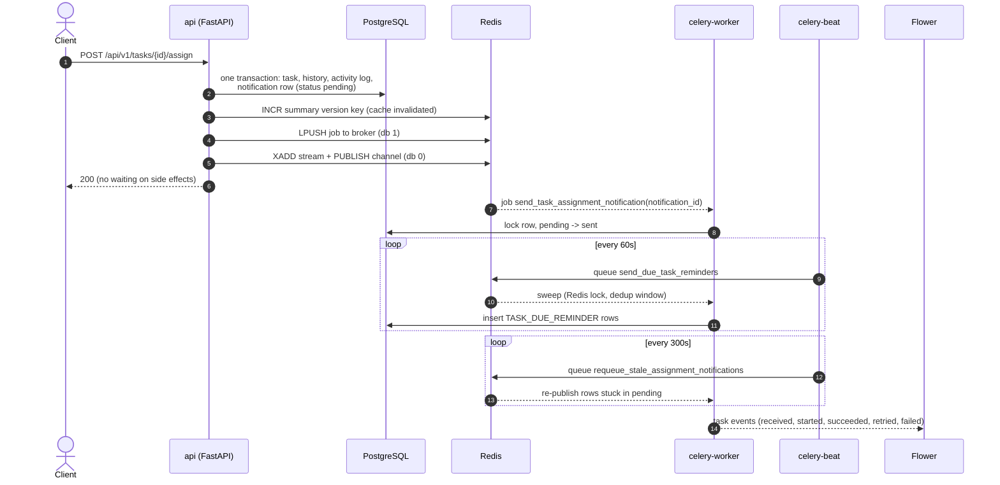

# End-to-End Flow: One Task Change Through the Whole Stack

Issue **#104**. The Session 05 pieces were built one at a time: the async API (#98), the
summary cache (#99), task events on Pub/Sub and Streams (#100), assignment notifications on
Celery (#101), and Beat reminders with Flower (#102). This document follows one task
change through all of them, lists the failure cases that are tested, and collects the open
tradeoffs in one place.

- Run it: `make docker-up`, then `make flow-demo` ([`scripts/demo_end_to_end.py`](../../scripts/demo_end_to_end.py))
- Walkthrough and evidence: [`demos/session-05/07-end-to-end-flow/demo.md`](../../demos/session-05/07-end-to-end-flow/demo.md)

---

## 1. The flow



The API only commits and hands work off. Everything slow or unreliable happens after the
response, and every hand-off has a way to recover when it fails (section 3).

## 2. Step by step

What happens for `POST /api/v1/tasks/{id}/assign` (`TaskService.assign_task` in
[`app/services/task_service.py`](../../app/services/task_service.py)), and where to see it.

| # | Step | Code | Where it shows |
|---|------|------|----------------|
| 1 | Lock the task row, validate the assignee and project membership | `_get_task_or_404(for_update=True)`, `verify_project_membership` | 404 / 403 / 409 responses |
| 2 | Stage the task change, assignment history, activity log, and a `pending` `TASK_ASSIGNED` notification (the outbox row) in **one transaction**, then commit | `stage_assignment_notification` | `SELECT * FROM notification WHERE task_id = …` |
| 3 | Invalidate the workspace's cached summary by bumping its version | `invalidate_summary` ([`app/cache/task_summary_cache.py`](../../app/cache/task_summary_cache.py)) | api log `Task summary cache INVALIDATED`; `GET taskflow:v1:ws:1:task_summary:version` |
| 4 | Queue the delivery job, off the event loop, failing fast if the broker is down | `_dispatch_assignment_notification` → `enqueue_assignment_notification` ([`app/tasks/notification_tasks.py`](../../app/tasks/notification_tasks.py)) | Flower → Tasks |
| 5 | Publish `task.assigned` (and `task.status_changed` if the status moved) to the Stream and the Pub/Sub channel | `publish_task_events` ([`app/events/publisher.py`](../../app/events/publisher.py)) | api log `Published task.assigned … stream_entry=…`; `make events-streams`; `XREVRANGE taskflow:task-events:stream + - COUNT 5` |
| 6 | Respond `200` | | 15–32 ms in `make flow-demo` |
| 7 | The worker locks the notification row and moves it `pending → sent`; it skips rows that are no longer `pending` (cancelled or already sent) | `send_task_assignment_notification` | worker log `Transitioned pending notification … to 'sent'`; Flower task page |
| 8 | Beat's sweep reminds the assignee once the task is due within a day | `send_due_task_reminders` ([`app/tasks/reminder_tasks.py`](../../app/tasks/reminder_tasks.py)) | `TASK_DUE_REMINDER` rows; Flower task result `reminded_task_ids` |
| 9 | Beat's outbox sweep re-publishes rows still `pending` after 5 minutes | `requeue_stale_assignment_notifications` | worker log; Flower |

`PATCH /api/v1/tasks/{id}/status` follows steps 1, 3, 5 and 6 (`TaskService.update_task_status`).
It has no notification. `POST /api/v1/tasks` with an `assignee_id` runs the whole flow
(`announce_new_task_assignee`).

**One request id end to end.** `RequestIdMiddleware` sets `X-Request-ID`. The id goes into
the event payload (`request_id`) and into the Celery message headers (`REQUEST_ID_HEADER` in
[`app/core/celery_app.py`](../../app/core/celery_app.py)), so the worker's log lines carry
the id of the API call that queued the job:

```bash
docker compose logs api celery-worker --no-log-prefix | grep <x-request-id>
```

Beat jobs are not started by a request, so their log lines show `-`.

## 3. Failure cases tested

Each row links to the tests or the scripted demo that prove it. The topic docs explain the
details: [`celery-jobs.md`](celery-jobs.md), [`redis-pubsub-vs-streams.md`](redis-pubsub-vs-streams.md),
[`celery-beat.md`](celery-beat.md), [`redis-caching.md`](redis-caching.md), and
[`async-programming.md`](async-programming.md).

| Failure | What happens | Proven by |
|---------|--------------|-----------|
| **Broker (Redis) down at commit** | The assignment stays committed and the API still returns 200, about 1s slower at most. The row stays `pending` until the outbox sweep re-publishes it. | `test_assign_task_broker_down_graceful_degradation`, `test_requeue_stale_assignment_notifications_publishes_through_the_broker` (`tests/integration/services/test_celery_assignment_flow.py`) |
| **Job lost after commit** | The sweep re-publishes rows `pending` for over 5 minutes, at most once per window, and marks a row `failed` after 10 re-queues. | `test_stale_pending_sweep_*` (same file) |
| **Worker offline** | Jobs wait in the broker queue and run when a worker starts. | `make celery-demo` (worker offline scenario) |
| **Worker crashes mid-job** | `task_acks_late` + `task_reject_on_worker_lost` redeliver the job, and the row lock plus the `pending` check make the redelivery a no-op if it already ran. | `test_process_assignment_notification_idempotent_duplicate` |
| **Transient error** (DB connection, network) | Retried with backoff of 1s, 2s, 4s, then marked `failed`. | `tests/unit/test_celery_notification_tasks.py` (`test_transient_failure_*`, `test_operational_error_retries_with_backoff`) |
| **Permanent error or bug** | Not retried. Marked `failed` with the error and raised, so it shows as failed in Flower. | `test_permanent_failure_does_not_retry`, `test_non_transient_errors_are_not_retried_and_mark_failed` |
| **Reassigned A → B → A quickly** | B's undelivered row is cancelled, a sent row stays sent, and A gets a new notification. A delivery that races the reassignment waits for its lock and skips the cancelled row. | `test_reassignment_*` (assignment flow), `test_delivery_waits_for_in_flight_reassignment_and_skips_cancelled_row` |
| **Event consumer offline** | Pub/Sub drops the event (`pubsub_receivers=0`). The Streams group keeps it and the consumer reads the backlog when it returns. | `tests/integration/events/test_pubsub_consumer.py`, `test_stream_consumer.py`; `make events-demo` |
| **Consumer crashes before `XACK`** | The entry is redelivered and the dedup marker on `event_id` skips the duplicate. | `test_stream_consumer.py`; `make events-demo` |
| **Redis down for events** | The publish error is logged and swallowed. The change stays committed and the event is lost (the dual-write gap). | `tests/integration/events/test_publisher.py` |
| **Redis down for the cache** | Fails open: the summary is served from Postgres, and stale data is bounded by the 30s TTL. | `test_summary_still_works_when_the_version_key_is_unreadable`, `tests/unit/db/test_redis_client.py` |
| **Write races a cache fill** | A summary computed before a write is stored under the old version and never served. | `test_a_summary_computed_before_a_write_is_never_served_after_it` |
| **Rolled-back write** | Publishes no event, queues no job, and leaves the cache alone. | `test_a_rolled_back_write_does_not_clear_the_cache`, `tests/integration/api/test_task_events_api.py` |
| **Overlapping Beat sweeps** | The second sweep finds the Redis lock held and skips. The lock is renewed while the holder runs. | `test_overlapping_sweep_skips_execution`, `test_lock_is_renewed_while_the_holder_runs` |
| **Sweep runs twice / Beat restarts** | The 24h dedup per task, assignee and due date stops duplicate reminders. | `test_due_task_reminders_idempotent_no_duplicates` |
| **One reminder fails to insert** | Its savepoint rolls back and the rest of the batch is kept. | `test_one_failing_reminder_does_not_roll_back_the_others` |
| **Slow external call** | `504` after the timeout. Other requests keep being served because the event loop is never blocked. | `tests/integration/api/test_task_summary_api.py` |

## 4. Open tradeoffs and questions

- **At least once everywhere, so every consumer must be idempotent.** Celery redelivers on
  a crash and Streams redeliver until `XACK`. That is handled with the notification row
  lock and the `event_id` dedup marker, at the cost of one extra lock or Lua call per
  message. Any new consumer has to do the same.
- **Events still have a dual-write gap.** Notifications go through the outbox, but task
  events are published straight after the commit. If Redis is down at that moment, the
  event is lost while the change stays committed. Publishing events from the outbox would
  close the gap, at the cost of a relay process and some extra latency.
- **Two event transports side by side.** Both are kept so they can be compared on the same
  traffic. Production would pick Streams for anything that must be acted on, and keep
  Pub/Sub (if at all) for "refresh now" hints.
- **Outbox sweep latency.** A notification whose publish failed is re-sent by the first
  sweep (every 300s) that runs once the row is 5 minutes old and the broker is back. That
  is 5–10 minutes after the failed publish, or up to 5 minutes after the broker recovers
  from a longer outage. The sweep job is queued through the broker too, so no sweep runs
  during the outage. Shorter intervals mean faster recovery and more sweep queries.
- **Beat is a single instance.** Two Beat processes would queue every job twice. The
  reminder lock and dedup make that harmless for reminders, but the schedule itself is not
  highly available. The schedule file is container-local, which is fine for fixed
  intervals.
- **Cache: version counter plus TTL.** Invalidation is a single `INCR` and cannot race a
  fill. The TTL (30s) caps staleness when an invalidation is lost and covers
  `overdue_count`, which changes at midnight. A write path that forgets to call
  `invalidate_summary` is stale for up to the TTL, and nothing flags it.
- **Notifications are only state changes.** `sent` means "the worker processed it". No
  email or push is delivered yet, so real delivery retries and provider errors are untested.
- **Flower holds task state in memory.** Its history resets on restart, and it can revoke
  tasks, so it is bound to loopback behind basic auth. It shows job health, not business
  outcomes, which are still in the logs and the `notification` table. Queue-depth and
  failure-rate alerts would need Prometheus or similar.
- **The broker shares Redis with the cache and events** (separate logical DBs). One Redis
  outage hits all three at once. Every path degrades safely, but together they are one
  failure domain.
